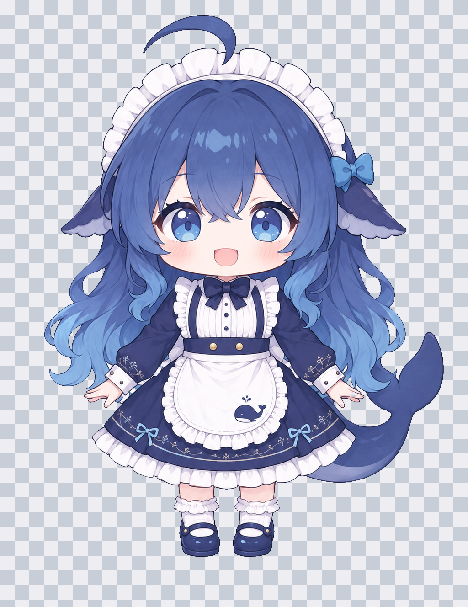
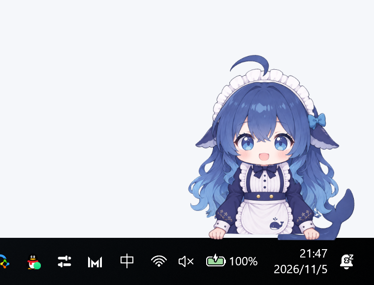
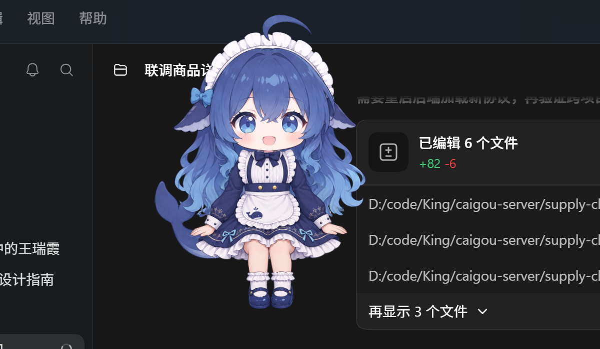
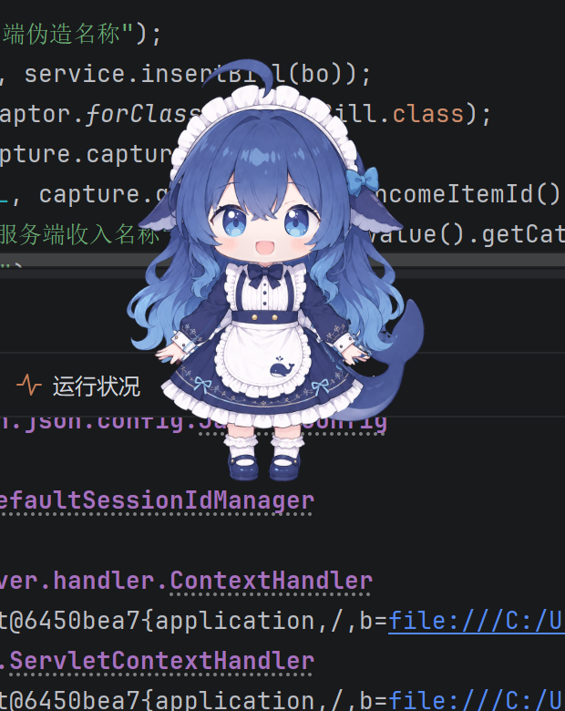
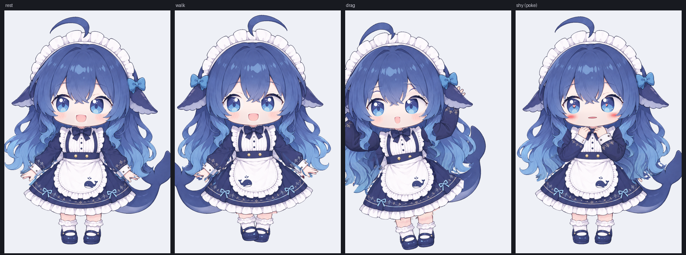
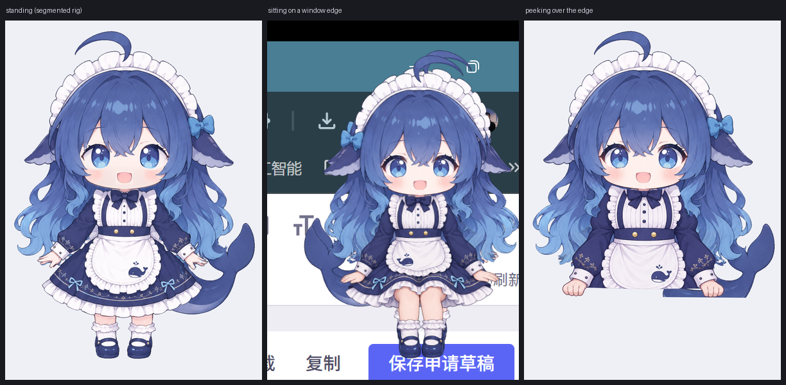

# dsh-mini-fish · 桌面宠物

> 给 **DeepSeek Harness 桌面端**养一只常驻桌面的宠物：透明、置顶、可拖拽、会看鼠标、会趴窗台，还会跟着 Agent 干活。



它不是网页里的浮层，而是一个**独立的 C# WPF 进程**（`companion/bin/PetHost.exe`）：插件负责拉起与喂事件，宿主进程负责窗口与渲染。关掉 Harness 主窗口它还在桌面上；Harness 退出它跟着退出。

```text
Harness 主进程 ──spawn/看门狗──> PetHost.exe（独立透明置顶窗口，60fps 分层合成）
      │                                   ▲
      └── signals.jsonl / balance.json ───┘（文件握手，无网络监听、无防火墙弹窗）
```

## 功能

| 能力 | 说明 |
| --- | --- |
| **独立进程** | 插件 `spawn` 一个 detached 的 `PetHost.exe`；主窗口隐藏/关闭不影响它。宿主带**父进程看门狗**（Harness 退出 2s 内自杀），插件侧另有 10s 看门狗，宿主崩了自动重拉 |
| **高帧率分层动画** | `CompositionTarget.Rendering` 帧循环，39 个透明图层按 `z` 合成；呼吸/摇摆/颠簸叠在分层骨骼上，动作层（举手、步态、悬空腿）第一次用到才解码 |
| **分层骨骼 + 弹簧** | 尾巴 3 段、后发 2 段、侧发 2×2、手臂 3 段用 `parent` 父子链串起来：子层先绕自身 pivot 旋转再叠加父层矩阵，弹簧目标逐段错相位，尾巴甩动是**波浪传导**而不是整块摆动 |
| **表情系统** | 眼 6 态 / 眉 5 态 / 口型 11 态 / 腮红 3 态 + `head_brow_ready` 变体；状态机 `Idle / Think / Work / Celebrate / Sad / Sleep / Drag / Poke / Alert` 映射到表情预设，眨眼四段式调度 |
| **目光跟随（待机回中）** | 独立的虹膜/瞳孔/高光层组按 `gaze.limit` 平移，眼白与眼线固定；鼠标移动时跟随，**鼠标停下约 1.5 秒后目光自己回正** |
| **可拖拽** | 拖起时身体倾斜、换成举手姿势 + 悬空腿 + 动作后发；从趴姿/坐姿被拖出来会先变回**完全体**；松手后 1 分钟内「放哪儿待哪儿」（前台窗口一变立即恢复自动行为） |
| **窗台与角落** | 前台窗口**稳定 5 秒**后才移动过去，坐姿坐在窗口上沿、腿垂在窗口前；位置按窗口宽度自适应：**够宽就贴右侧但避开标题栏按钮**（按 `SM_CXSIZE` 让开最小化/最大化/关闭那一排再留 10 DIP），**窗口太窄就改坐左上角**，保证不挡操作按钮；全屏/最大化窗口不趴窗台，改为**右下角趴着**（上半身探出、手搭底边）；没窗口可趴且长时间没人理，会溜到工作区底边探头（彩蛋） |
| **空闲散步** | 系统键鼠空闲 + 无任务 + 60s 没操作才走，4 帧步态配合步频颠簸；一有输入/任务/切换窗口立刻停 |
| **任务联动** | 把每个 Agent 回合当成一个任务：开工台词、按步数报进度、结束按「步数 · 耗时」总结并庆祝、出错安慰 |
| **余额徽标** | 只在悬浮 / 单击 / 右键「查看余额」时短暂出现约 10 秒，显示平台剩余额度（充值 + 赠送合计），数据每 5 分钟刷新 |
| **不打扰** | 气泡只在有话说时出现、只留最新一句、自动淡出；默认**不睡觉**（`sleep: false`） |
| **置顶守卫** | 别处把她挤出头层（`HWND_NOTOPMOST` / shell 过渡 / 窗口管理器重排）时，`WM_WINDOWPOSCHANGING` 直接否决，帧循环每 0.5s 再兜底复查真实 z 序；任务栏与其他置顶程序的正常遮挡不抢 |
| **多显示器 / 高 DPI** | 按宿主所在显示器的 DPI 换算坐标与窗口位置；立绘位图按实际显示尺寸解码，缩放/跨屏时自动重解码 |

想看细节设计可以读 [`docs/dsh-pet-feasibility.md`](docs/dsh-pet-feasibility.md)（可行性 + 实测数据）和 [`docs/behavior-supplement-v2-review.md`](docs/behavior-supplement-v2-review.md)（行为补充素材验收记录）。

### 效果

| 全屏时在右下角趴着 | 坐在前台窗口上沿 |
| --- | --- |
|  |  |

| 拖出来变成完全体 | 鼠标停下后目光回正 |
| --- | --- |
|  |  |

| 分段骨骼 + 步态 | 坐姿 / 探头整图姿态 |
| --- | --- |
|  |  |

## 安装

### 前置条件

- **Windows 10 / 11**（x64）。宿主是 .NET Framework 4.x 的 WPF 程序，当前只有 Windows 实现。
- **.NET Framework 4.x**（系统自带）。首次启动时插件会用系统自带的 `csc.exe` 把 `companion/src/PetHost.cs` 编译成 `companion/bin/PetHost.exe`，之后直接拉起，不再编译。
- **DeepSeek Harness 桌面端**：插件通过 profile 的 `dsh.profile.bundles` 挂进桌面端。

### 桌面端「添加插件」（推荐）

设置 → 插件 → **添加插件**，输入框填下面任意一种，安装后「立即启用」并重启 Harness：

```text
github:Anixuil/dsh-mini-fish                     # 装仓库 main 的当前代码
git+https://github.com/Anixuil/dsh-mini-fish.git # 完整 git 地址
```

本包没有 JS 构建步骤，从 GitHub 安装不会被 pnpm 的 `allowBuilds` 卡住；宿主 C# 的编译在第一次启动时自动完成。

> 包名是 `@local/dsh-pet`（仅供本地 / 仓库安装，未发布到 npm；`private: true`）。

### 本地目录（开发用）

仓库本身就是插件包，直接把 profile 的依赖指向它：

```jsonc
// ~/.dsh/profiles/desktop/package.json
{
  "dependencies": {
    "@local/dsh-pet": "link:D:/code/self/all/dsh-mini-fish"
  },
  "dsh": {
    "profile": {
      "bundles": ["@local/dsh-pet"]
    }
  }
}
```

Windows 上 `link:` 有时不会生成联接，可以手动补一个目录联接：

```powershell
New-Item -ItemType Junction `
  -Path "$env:USERPROFILE\.dsh\profiles\desktop\node_modules\@local\dsh-pet" `
  -Target "D:\code\self\all\dsh-mini-fish"
```

### 用 dsh CLI

桌面端自带 CLI（不在 PATH 里）：

```powershell
& "$env:LOCALAPPDATA\Programs\DeepSeek Harness\resources\runtime\cli\bin\dsh.cmd" plugin list
```

### 卸载 / 关闭

插件页把 `dsh-pet` 禁用或移除即可；桌宠进程会随插件卸载一起退出。想临时收掉宠物：右键她 →「退出桌宠」（这会在 `%LOCALAPPDATA%\dsh-pet\pet.closed` 留标记，插件不再自动重拉；重启 Harness 或删掉标记即可恢复）。

## 配置

配置在 bundle 的 `config` 段里（本仓库的 [`cordis.patch.yml`](cordis.patch.yml) 就是默认值）：

```yaml
- insert:
    - id: dsh-pet
      name: '@local/dsh-pet'
      config:
        enabled: true
        petId: whale-maid-l1
        reactToAgent: true
        showBalance: true
        sleep: false
        windowAware: true
        walkIdleSeconds: 60
```

| 键 | 默认 | 说明 |
| --- | --- | --- |
| `enabled` | `true` | `false` 时不拉起宿主（插件仍在插件列表里） |
| `petId` | `whale-maid-l1` | 宠物包目录名；找不到时回退默认包，再回退 `pets/` 下第一个可用包 |
| `petsDir` | 仓库内 `pets/` | 自定义宠物包目录（绝对路径） |
| `scale` | `1.0` | 额外缩放。最终大小 = `canvas.baseScale × state.scale × config.scale`，可调 0.5–2 |
| `clickThrough` | `false` | 启动即点击穿透（右键菜单 / `Ctrl+Alt+P` 可切换） |
| `sleep` | `false` | `true` 时 5 分钟无活动打瞌睡（闭眼 + Zzz）；默认关闭 |
| `showBalance` | `true` | 余额徽标；`false` 时不读余额、不显示 |
| `windowAware` | `true` | 跟随前台窗口趴窗台；`false` 时只在自己那一小块待着 |
| `walkIdleSeconds` | `60` | 空闲散步门槛（秒）：系统键鼠空闲、无任务、无前台窗口可趴都满足才走 |
| `reactToAgent` | `true` | Agent 事件联动（台词 / 动作 / 庆祝）；`false` 只保留本地交互 |

运行状态（位置、缩放、置顶、穿透等）存在 `%LOCALAPPDATA%\dsh-pet\state.json`，改动即时生效，不需要重启。

## 交互

| 操作 | 反应 |
| --- | --- |
| 鼠标移动 | 虹膜跟随；停下约 1.5s 目光回正 |
| 单击 | 害羞（合十手 + 深腮红 + 爱心瞳孔）+ 气泡 |
| 双击 | 转一圈庆祝（0 → 翻面 → 0，完整归位） |
| 拖拽 | 被拎着走：倾斜 + 举手 + 悬空腿 + 后发动作；松手落地，1 分钟内留在放下位置 |
| 右键 | 菜单：始终置顶 / 点击穿透 / 跟随前台窗口 / 查看前台窗口 / 显示余额徽标 / 查看余额 / 大小 50%–110% / 回到右下角 / 退出桌宠 |
| `Ctrl+Alt+P` | 切换点击穿透（穿透后鼠标直接点到下面的窗口） |
| `Ctrl+Alt+Q` | 退出桌宠（等同右键「退出桌宠」） |

## 与 Agent 联动

插件订阅 Harness 事件，写进 `%LOCALAPPDATA%\dsh-pet\signals.jsonl`，宿主增量读取（tail），无网络监听：

| Harness 事件 | 桌宠反应 |
| --- | --- |
| `agent/status → running` | 思考态（歪头） |
| `agent/assistant-stream`（250ms 节流） | 抬头 + 说话口型 |
| `tools/result` 成功 / 失败 | 工作态 / 委屈态 |
| `agent/turn-stopping` | 庆祝：跳一下 + 星星 + 「搞定啦！」 |
| `agent/error` | 委屈：垂耳 + 「呜…出错了」 |
| `goal/changed` | 庆祝 + 星星 |
| `task.start` / `task.progress` / `task.done` / `task.failed` | 开工台词 / 第 N 步 / 「搞定！N 步 · N 秒」/ 失败安慰 |
| `user.question` | 提醒态（「在等你回答～」） |

另外宿主还接受 QA 信号：`pet.twirl`、`pet.poke`、`pet.sleep`、`pet.blink`、`pet.balance`、`pet.walk`、`pet.drag`、`pet.say`，方便手工验证。

## 宠物包（DPF）

宠物包是纯数据：一个目录 + `pet.json` + 全画布透明 PNG 图层。仓库里带三个包：

| 目录 | 用途 | 说明 |
| --- | --- | --- |
| `pets/whale-maid-l1` | 完整示例（L1） | 蓝鲸女仆 · 小蓝，39 层，7.09 MB：分层骨骼、虹膜眼组、整图姿态、动作层一应俱全 |
| `pets/whale-maid` | 最小示例（L0） | 单层 `body.png`（343×444），只够验证「能跑」：呼吸 + 拖拽 |
| `pets/_template-l1` | 作者起手模板 | 只有 manifest + 画布导引 + 图层交付清单（`CHECKLIST.md`），没有图片，复制后自己补 `parts/` |

```text
pets/whale-maid-l1/
├── pet.json              # manifest：canvas / layers / eyesRig / poses …
├── parts/                # 全画布 RGBA 图层（1024×1328）
│   ├── body.png  head.png  hair_front.png  …
│   ├── eye_static_l_open.png  eye_moving_l.png  …   # 虹膜眼组
│   ├── sit_pose.png  peek_pose.png                  # 整图姿态
│   └── walk_1..4.png  arm_l_up.png  legs_air.png    # 按需解码的动作层
├── masks/                # 眼眶遮罩
├── LICENSE               # 素材授权（本包 CC-BY-NC-4.0，非商业同人）
└── README.md
```

自己做一个宠物包：复制 `pets/whale-maid-l1` 改 `id` / `canvas` / 图层，或在配置里用 `petsDir` + `petId` 指向别处。**完整字段说明见 [`docs/pet-pack-format.md`](docs/pet-pack-format.md)**（DPF v1：图层、父子骨骼、弹簧组、变体、隐藏/退役、眼组、整图姿态、8MB 包体上限）。

校验一个包：

```powershell
python tools/check-pet-pack.py pets/whale-maid-l1   # 图层/变体/姿态/父子链/透明画布检查
node dev/smoke.mjs                                  # 插件清单 + 包完整性（= npm test）
```

> 素材源文件（母版分层、三视图、母版 zip）体积太大，不在仓库内；仓库只带成品宠物包。

## 性能

| 指标 | 实测（3120×2080 @2x DPI，缩放 81%） |
| --- | --- |
| CPU | 约 18–30% 单核（多核机器基本无感） |
| 内存 | 约 360–480 MB |
| 帧率 | 锁 `CompositionTarget.Rendering`（约 60fps） |

透明分层窗口走 WPF 的软件合成，开销主要在窗口级像素合成，而不是图层数量；为此做了这些省法：位图按**实际显示尺寸**解码（512–1024，随缩放/DPI 重解码）、动作层懒解码、`retired` 层永不加载、隐藏层 `Collapsed`。

## 开发与 QA

```powershell
pwsh tools/build-companion.ps1     # 编译宿主 companion/bin/PetHost.exe（插件也会自动编译）
pwsh tools/build-tools.ps1         # 编译 QA 小工具：截屏 / 命中测试 / 光标 / 真实拖拽
python tools/check-pet-pack.py pets/whale-maid-l1
node dev/smoke.mjs                 # 清单、locale、图标、宠物包完整性
```

宿主自带一组**离屏 / 可观测** QA 钩子（不影响正常使用）：

```text
PetHost.exe --dump-frame out.png             离屏渲染当前合成帧（不显示窗口）
            --dump-delay 800                 等场景稳定后再 dump
            --hide-layers tail,head          隐藏指定层做逐层隔离
            --reload-decode 1024             强制按指定宽度重解码（验证缩放重解码路径）
            --qa-trace trace.txt             每 0.5s 追加一行前台/目标/姿态/位置/目光轨迹
            --qa-fg-file fg.txt              用文件模拟前台窗口 "left,top,w,h[,fullscreen]"
            --qa-cursor 200,1200             钉住光标位置（验证目光跟随/待机回中）
            --qa-mode walk|drag|poke|sit|peek|stand|corner|perch-sit
            --qa-instance                    允许与正式桌宠并存（QA 用）
```

典型排查流：`--qa-trace` 看控制器决策 → `--dump-frame` 看真实合成（截屏会被桌面合成干扰）→ 对差异像素做 diff。

## 目录结构

```text
dsh-mini-fish/
├── index.js                # DSH 插件：生命周期 + 事件桥 + 余额
├── cordis.patch.yml        # bundle patch（插入 dsh-pet 行与默认 config）
├── package.json            # dsh.bundle.patch / exports / files / icon
├── locale/{en,zh}.json     # 插件列表里的标题与描述
├── icon.svg
├── companion/src/PetHost.cs# C# WPF 宿主（窗口、渲染、骨骼、姿态、前台窗口感知）
├── companion/bin/          # 构建产物（不入库，首次启动自动编译）
├── pets/whale-maid-l1/     # 示例宠物包（CC-BY-NC-4.0）
├── docs/                   # 可行性、行为验收、宠物包格式
├── dev/smoke.mjs           # 仓库自检
└── tools/                  # 构建脚本、宠物包校验、QA 工具源码
```

## 常见问题

- **桌宠不出现**：先看 `%LOCALAPPDATA%\dsh-pet\spawn.log`（插件拉起日志）和 `crash.log`（宿主异常）；再确认 `%LOCALAPPDATA%\dsh-pet\pet.closed` 不存在（用户点过「退出桌宠」后插件不再重拉，重启 Harness 或删标记）。
- **首次启动慢 1–3 秒**：宿主要先用 `csc` 编译，之后不会再编译。
- **点不到 / 点穿了**：`Ctrl+Alt+P` 切换点击穿透；右键菜单里的「点击穿透」勾选状态就是当前值。
- **桌宠被窗口遮住了 / 层级变低**：宿主内置了**置顶守卫**。窗口的 `WS_EX_TOPMOST` 位不是承诺——别的程序调 `SetWindowPos(HWND_NOTOPMOST)`、shell/DWM 过渡、或者窗口管理器重排置顶带，都可能把她挤到普通窗口下面；WPF 只在 `Topmost` 属性**变化**时才重新置顶，所以一旦被挤下去就会一直埋着。现在宿主在 `WM_WINDOWPOSCHANGING` 里**直接否决**任何把她移出置顶带的请求，并在帧循环里每 0.5s 复查一次真实 z 序（`GW_HWNDPREV` + 可见性 + 是否置顶）作为兜底。任务栏、其他「始终置顶」程序的窗口属于正常遮挡，守卫不会跟它们抢。
- **坐在窗口上沿会挡住最小化/关闭按钮**：已修。座位按窗口宽度自适应——窗口够宽时贴右侧，但按 `SM_CXSIZE` 让开标题栏按钮那一排（再留 10 DIP 余量）；窗口窄到没法既贴右又避开按钮时，改坐**左上角**（标题栏左端只有图标和标题文字，不承载操作）。判定阈值约 248 DIP 宽（按钮 96 + 余量 20 + 立绘宽度）。
- **独占全屏游戏里看不到宠物**：独占全屏（Exclusive FullScreen）会盖掉置顶窗口，这是系统行为；无边框全屏（Borderless）正常。
- **多显示器 / 高 DPI**：坐标按宿主所在显示器的 DPI 换算；跨屏拖动时会重新解码位图，偶有 1–2 帧的模糊过渡。
- **CPU 偏高**：透明分层窗口是软件合成，长时间 60fps 常驻不可避免；可把大小调小（右键 → 大小）以减少像素量。

## 许可

- **插件代码**（`index.js`、`companion/src/`、`tools/`、`dev/`、`docs/`）：MIT，见 [LICENSE](LICENSE)。
- **宠物包素材**（`pets/*/`）：同人作品，CC-BY-NC-4.0（非商业），商业使用需取得角色作者授权，见 `pets/whale-maid-l1/LICENSE`。

## 致谢

宠物包「蓝鲸女仆 · 小蓝」基于用户确认的母版分层重绘与拆层；宿主的分层骨骼、眼组、整图姿态、窗台规则都在下面对应文档里记录了实测过程：

- [`docs/dsh-pet-feasibility.md`](docs/dsh-pet-feasibility.md) — 可行性、架构、逐项验收
- [`docs/behavior-supplement-v2-review.md`](docs/behavior-supplement-v2-review.md) — 行为补充素材（Phase 1–3）与后续修正
- [`docs/pet-pack-format.md`](docs/pet-pack-format.md) — DPF v1 宠物包规范
